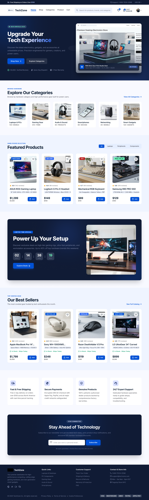

# TechZone - Electronics Store UI/UX Design

UI/UX design for TechZone, a desktop e-commerce experience for an electronics store, designed in Figma.

## Figma prototype

[Open the interactive prototype in Figma](https://www.figma.com/proto/vCD5guwBSUvAA1wXaNcp5Q/Untitled?node-id=1-1387&p=f&t=Zwj0dP7Fc19gW7Pa-1&scaling=min-zoom&content-scaling=fixed&page-id=0%3A1&starting-point-node-id=1%3A1387)

## Design overview

- Desktop experience on a 1440px grid
- Dark navy theme with blue accents
- Full shopping flow: Home > Search / Categories > Product details > Cart > Checkout
- Search includes three designed states: initial, results and no results
- Checkout is structured in three steps: Shopping Cart > Shipping Info > Payment

## Screens

Screen captures live in the [design](design/) folder. See [design/design-notes.md](design/design-notes.md) for details on each screen.

### Home

### Search (initial state)

### Categories

### Product details

### Shopping cart

## Status

Design phase only. All product names, prices and copy are placeholder demo content. Converting the design into a working website is planned as a later step; this repository holds the design files.
