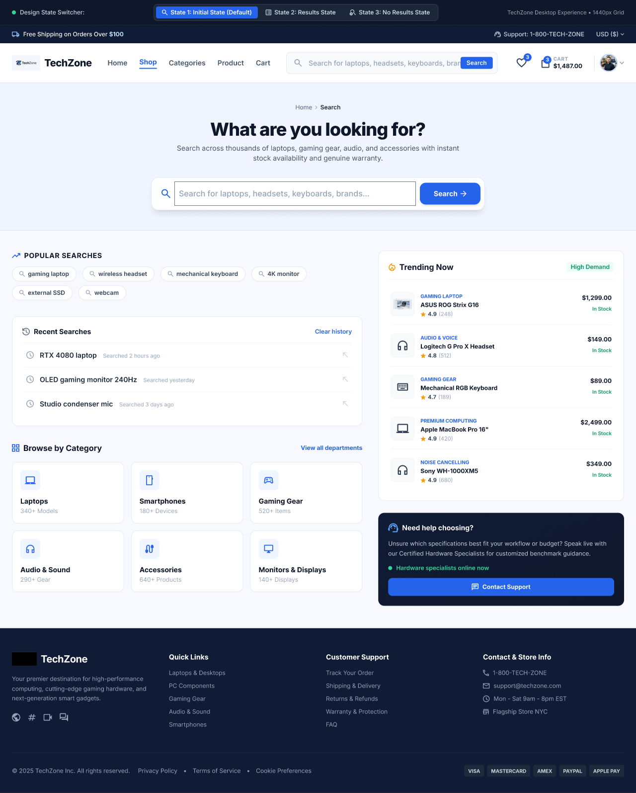
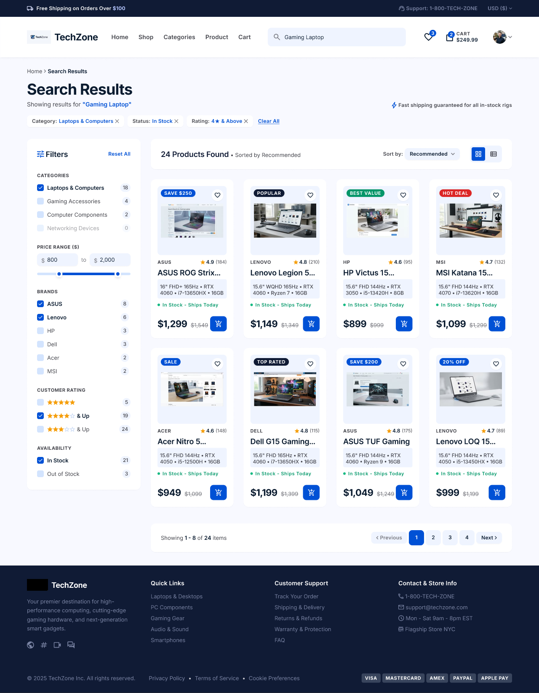
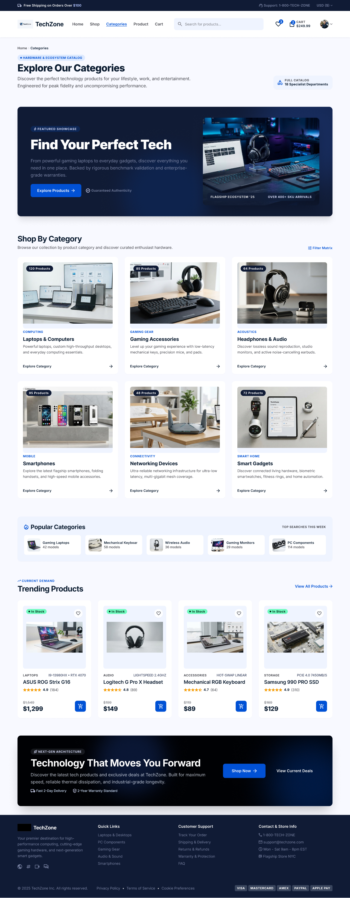
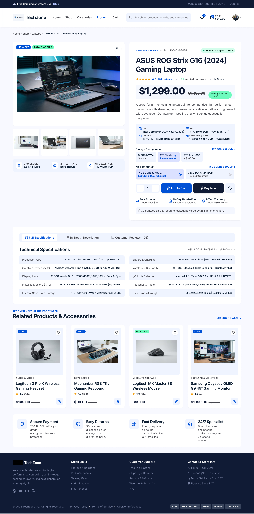
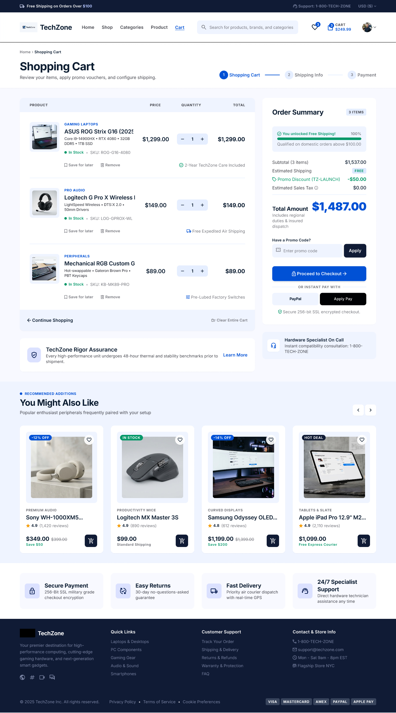
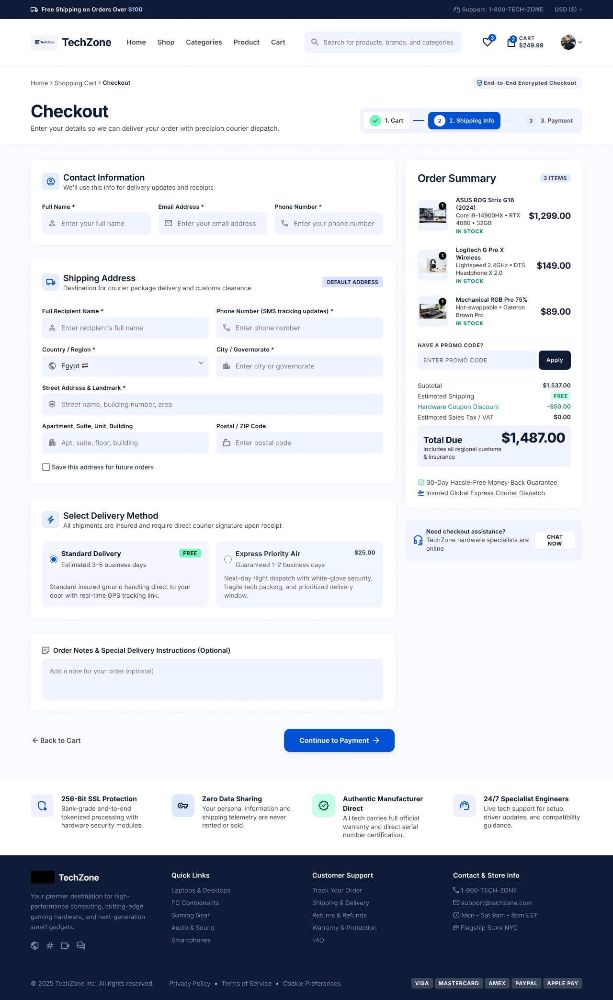
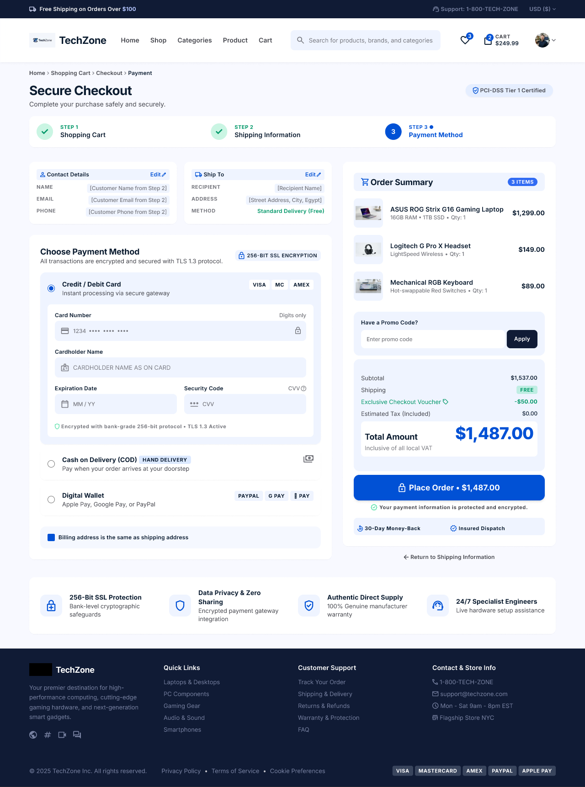
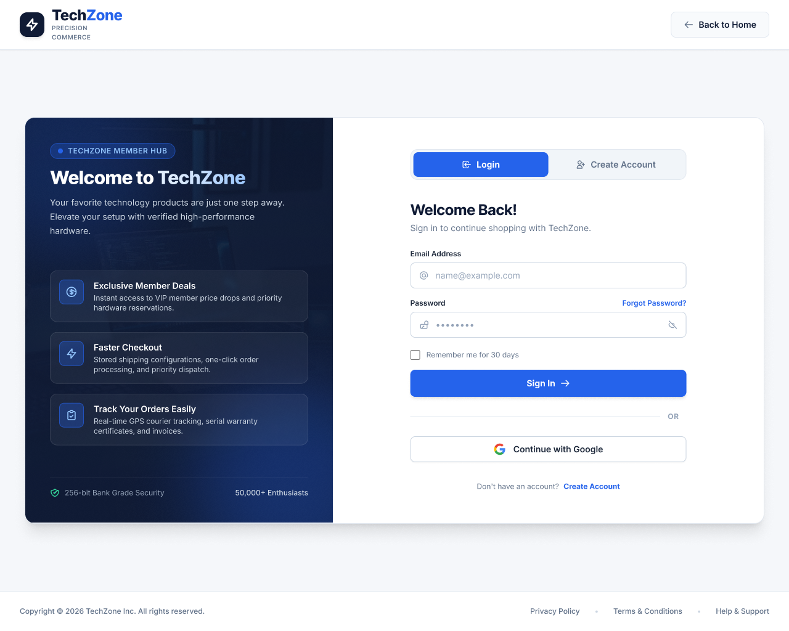
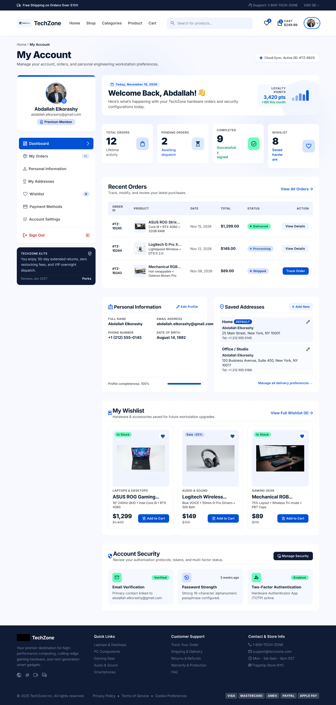

# TechZone — Electronics Store UI (Figma Design Project)

# 📌 Project Overview
TechZone is a desktop e-commerce UI design for a premium electronics store, designed in Figma on a 1440px grid. This repository documents the complete design: full-length captures of every screen and links to the live Figma project.

## 👥 Team Members
 
| #   | Name                                   | Section    |  GitHub                                                     |
| --- | -------------------------------------- | ---------- | ----------------------------------------------------------  |
| 1   |   Muhammad Saleh Fetouh Elsayad        | C6         | [elsayadm901-1211](https://github.com/elsayadm901-1211)     |
| 2   |  Abdallah Mohammed Elsayed Elkorashy   | C4         | [abdallahelkorashy](https://github.com/abdallahelkorashy)   |
| 3   |   Omar Elbakry Yehia Elbakry Yehia     | C4         | [Omar-Elbakry-Yehia](https://github.com/Omar-Elbakry-Yehia) |
| 4   |   Omar Abdelaziem Muhammad Soliman     | C4         | [mazenalrasi1](https://github.com/mazenalrasi1)             |
 

## Figma links

- Interactive prototype: https://www.figma.com/proto/vCD5guwBSUvAA1wXaNcp5Q/Untitled?node-id=1-1387&p=f&scaling=min-zoom&content-scaling=fixed&page-id=0%3A1&starting-point-node-id=1%3A1387
- Design file (view only): https://www.figma.com/design/vCD5guwBSUvAA1wXaNcp5Q/Untitled?node-id=0-1

## Screens

The design file contains exactly 10 top-level frames. Full-length captures of each are in [`design/`](design).

### 01 — Home
Hero banner, category browse, featured products, best sellers, deals countdown, newsletter, footer.

### 02 — Shop
Search/browse landing ("What are you looking for?") with popular searches, recent searches, trending products, and category browse. Topped by the Design State Switcher (Initial / Results / No Results).

### 03 — Search
Search results for "Gaming Laptop": filters sidebar (category, price, brand, rating, availability), sort control, product grid, pagination.

### 04 — Categories
Catalog landing: featured showcase, shop-by-category grid (6 departments), popular categories, trending products.

### 05 — Product
Product detail (ASUS ROG Strix G16): image gallery with thumbnails, price/discount, spec highlights, storage and memory configuration, add to cart / buy now, full specifications, related products.

### 06 — Cart
Shopping cart: line items with quantity controls, order summary with promo code, instant-pay options, recommended additions.

### 07 — Checkout
Checkout step 2 (Shipping Info): contact information, shipping address (Egypt default), delivery method selection, order notes.

### 08 — Payment
Checkout step 3 (Payment Method): credit/debit card form, cash on delivery, digital wallet options, order summary, place order.

### 09 — Login & Register
Sign-in screen with member-benefits panel; Create Account available as a tab variant inside the same frame.

### 10 — My Account Dashboard
Account overview: profile card, order stats, recent orders with statuses, personal information, saved addresses, wishlist, account security.

## Notes

- Search states: the Shop screen carries a "Design State Switcher" strip (State 1 Initial, State 2 Results, State 3 No Results). State 2 exists as the separate Search frame (03-search). State 3 is a decorative control only; no designed no-results state exists in the file (confirmed with the designer).
- Captures were rendered full-length from the Figma prototype at 1280px width; every image shows the complete frame from header to footer.
- Repository visibility: private.
